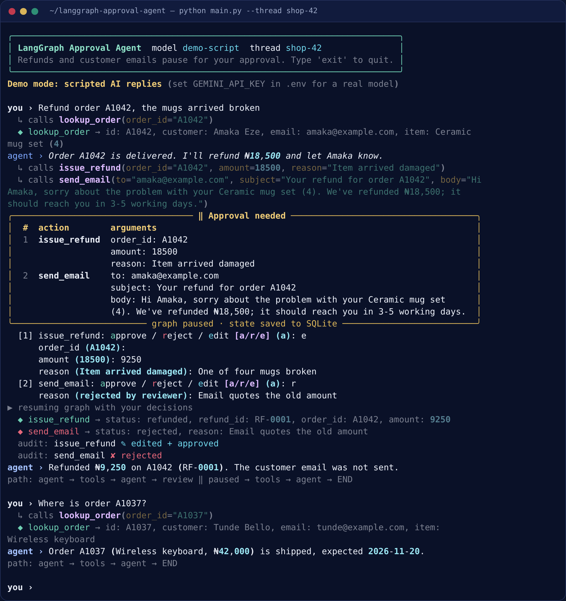

# ⏸️ LangGraph Approval Agent

> **Day 9 of [30 Days of AI Agents](https://github.com/obiokoye)**: a support agent built with LangGraph that can refund orders and email customers, but pauses for a human to approve, reject or edit each risky action, and can resume later from saved state.




## What it shows

- **Human-in-the-loop with `interrupt()`**: the `review` node calls LangGraph's `interrupt()`. The run stops, and only continues when you send `Command(resume=decisions)`.
- **Stateful graphs and checkpoints**: every step is saved to SQLite by `thread_id`. Quit at the approval prompt, run `python main.py --thread shop-42` later (even after a reboot) and it picks up at the same question.
- **Conditional routing**: read-only tools (`lookup_order`, `find_orders`) run straight away; `issue_refund` and `send_email` are routed through review first.
- **Approve, reject or edit**: a reviewer can change the arguments (e.g. lower a refund), or reject with a reason that is sent back to the model so it can explain what happened.
- **Fail closed + audit trail**: a risky call with no decision does not run, and every decision is recorded in the graph state's `audit` list.
- **Swappable providers and demo mode**: Gemini, Groq, OpenAI or Anthropic via one OpenAI-compatible client, or scripted replies with no key.
- **Offline tests**: 21 pytest tests with fake LLM clients, including pausing in one graph and resuming in a fresh one from the same SQLite file.

## Quick start

```bash
git clone https://github.com/obiokoye/langgraph-approval-agent.git
cd langgraph-approval-agent
python -m venv .venv && source .venv/bin/activate
pip install -r requirements.txt
cp .env.example .env      # add a free Gemini key from https://aistudio.google.com/apikey
python main.py
```

### Windows

```bat
git clone https://github.com/obiokoye/langgraph-approval-agent.git
cd langgraph-approval-agent
python -m venv .venv
.venv\Scripts\activate
pip install -r requirements.txt
copy .env.example .env
python main.py
```

Try: `Refund order A1042, the mugs arrived broken`, then answer `a` (approve), `r` (reject) or `e` (edit) for each action.

### Command-line options

| Command | What it does |
|---|---|
| `python main.py` | Chat on a new thread |
| `python main.py --thread shop-42` | Start or resume a named thread (resumes a pending approval) |
| `python main.py "Where is order A1037?"` | Send one message and exit |
| `python main.py --auto reject "Refund A1042"` | Answer approvals automatically (for scripts) |
| `python main.py --db other.sqlite` | Use a different checkpoint file |

## Demo mode

With `DEMO_MODE=true` in `.env`, or when no API key is set, the app prints **"Demo mode: scripted AI replies"** and uses `DemoClient` from `agent/fake.py`, the same fake client the tests use. The graph, checkpoints, approvals and tools are all real; only the model's replies are scripted. Scripted conversations:

- `Refund order A1042, the mugs arrived broken` (lookup, then a refund and an email that need approval)
- `Where is order A1037?` (read-only, no pause)
- `Which orders does chioma@example.com have?`
- `Refund order A1029` (already refunded in full, so nothing to approve)

The shop data (three orders) lives in memory in `agent/shop.py` and resets on each run.

## Switching providers

| `LLM_PROVIDER` | Key variable        | Default model             | Free tier |
|----------------|---------------------|---------------------------|-----------|
| `gemini`       | `GEMINI_API_KEY`    | `gemini-2.5-flash`        | ✅ |
| `groq`         | `GROQ_API_KEY`      | `llama-3.3-70b-versatile` | ✅ |
| `openai`       | `OPENAI_API_KEY`    | `gpt-4o-mini`             | ❌ |
| `anthropic`    | `ANTHROPIC_API_KEY` | `claude-haiku-4-5`        | ❌ |

Override the model with `LLM_MODEL=...`.

## How the graph works

```text
START → agent ──(no tool calls)─────────────────────────→ END
          │
          ├─(only read-only tools)─────────→ tools → agent
          │
          └─(issue_refund / send_email)→ review ‖ interrupt() → tools → agent
```

## Project structure

```text
agent/
  graph.py      # state, nodes (agent, review, tools), routing, build_graph()
  shop.py       # fake shop data, tools, JSON schemas, REQUIRES_APPROVAL
  fake.py       # ScriptedClient (tests) + DemoClient (tests and demo mode)
  providers.py  # provider config and demo-mode switch
main.py         # Rich terminal UI, approval prompts, SQLite checkpointer
tests/          # pytest, no network or API key needed
```

## Extending it

- **Gate a new tool**: add the function and schema in `agent/shop.py`, then add its name to `REQUIRES_APPROVAL`.
- **Smarter policy**: change `route_after_agent` in `agent/graph.py`, e.g. auto-approve refunds under ₦5,000.
- **Different front end**: the graph doesn't know about the terminal. A web app could read `graph.get_state(config).tasks[0].interrupts` and resume with `graph.invoke(Command(resume=...), config)`.

## Run tests

```bash
pytest -q
```

New to Python or LangGraph? See **[LEARN.md](LEARN.md)**, which walks through this codebase in Laravel terms.

---

MIT © Nicholas Okoye
